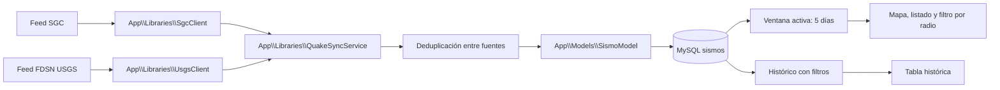

# Arquitectura del sistema de sismos

## Alcance actual (v1.0.3)

La aplicación muestra eventos sísmicos de todo el mundo en un visor Leaflet, conserva un
histórico consultable y unifica dos fuentes:

- **SGC** (Servicio Geológico Colombiano): cobertura local y mayor detalle instrumental.
- **USGS** (U.S. Geological Survey): cobertura mundial, magnitud 2.5+ por defecto.

Además incluye una **red ciudadana de teléfonos Android** que detecta ondas P y alerta a
los teléfonos cercanos. La red se documenta en `docs/RED_TELEFONOS.md` y su API en
`docs/API_RED.md`.

## Flujo de datos



## Fuentes y sincronización

- Feed SGC: `https://archive.sgc.gov.co/feed/v1.0.1/summary/five_days_2.json`.
- Feed USGS: `https://earthquake.usgs.gov/fdsnws/event/1/query?format=geojson` con
  `minmagnitude=2.5` y ventana de cinco días.
- Endpoint interno: `GET /sismos/sync`.
- El navegador consulta el endpoint cada 15 segundos.
- El backend cachea la respuesta en `writable/cache/quakes-sync.json` durante
  `quakes.cacheSeconds` (60 s por defecto).
- La misma sincronización se puede ejecutar por CLI: `php spark sigra:sync`.
- Una fuente caída no impide guardar la otra; los errores se reportan por fuente.
- Los duplicados entre SGC y USGS se descartan por cercanía (75 km) y tiempo (120 s).
- Las propiedades originales se guardan en `sgc_metadata` como JSON.
- Solo los eventos nuevos del SGC generan alertas de la red ciudadana.

## Rutas actuales

| Ruta | Función |
|---|---|
| `/sismos` | Mapa global, listado, filtros y radio de cercanía |
| `/sismos/sync` | Endpoint JSON interno de sincronización |
| `/sismos/historico` | Histórico con filtros de fecha, dirección y orden |
| `/sismos/create` | Reporte ciudadano con selección de ubicación |
| `/sismos/detalle/{id}` | Ficha de lectura del evento (SGC o USGS) |
| `/sismos/globales` | Redirección 301 a `/sismos` (compatibilidad) |
| `/red` | Panel público de la red de teléfonos |
| `/api/red/*` | API de la app Android (registro, latido, detección, alertas) |
| `/api/sismos/*` | API JSON de eventos, con filtro por radio |
| `/api/health` | Salud del servicio y de la base de datos |

## Ventana activa y filtro por radio

- La ventana activa es de cinco días para todas las fuentes.
- El filtro geográfico se aplica en el navegador: el servidor entrega la ventana completa
  y el cliente calcula distancias con Haversine.
- La API también acepta `lat`, `lng`, `radius_km` y `order=distancia` para clientes móviles.
- La geolocalización es opcional. Las coordenadas del usuario nunca se envían al servidor.
- El radio elegido se guarda en `localStorage`.

## Red de teléfonos

La red usa las tablas `red_devices`, `red_detections`, `red_alerts` y
`red_alert_deliveries`. La fusión TDOA y las reglas de alerta viven en
`App\Libraries\PwaveFusion` y `App\Libraries\RedNetworkService`.

```text
Acelerómetro -> STA/LTA en el teléfono -> POST /api/red/deteccion
-> agrupación espacial/temporal -> TDOA -> magnitud y confianza
-> alerta -> FCM y/o polling -> notificación full-screen con ETA de onda S
```

Los eventos oficiales nuevos del SGC (últimos 15 minutos) también se convierten en alertas
informativas mediante `RedNetworkService::crearAlertaSgc()`.

El controlador `app/Controllers/Sismos.php` funciona como router. La lógica de acceso y
presentación vive en las vistas y el acceso a datos en `SismoModel`.

## Ficha de evento

Al pulsar una tarjeta se abre una ficha propia. Según la fuente muestra:

- ID, magnitud, tipo de magnitud y profundidad.
- Coordenadas, ubicación y fecha.
- Agencia y estado.
- **SGC**: estaciones, RMS, GAP, MMI, CDI, PGA, municipios cercanos y mapa oficial.
- **USGS**: reportes sentidos, MMI, CDI, alerta, tsunami, significancia y enlace oficial.

El mapa oficial del SGC se muestra como producto externo; no se copia ni se modifica.

## Alertas del navegador y de la app

El sitio no usa SMS, OTP ni Twilio. Las alertas se entregan por:

- **Web Notifications** con permiso explícito.
- **Overlay de emergencia** con magnitud, distancia y cuenta atrás hasta la onda S.
- **Service worker + PWA** para instalar SIGRA como aplicación web.
- **App Android** con notificaciones de alta prioridad y polling de respaldo.
- **Panel `/red`** con mapa, propagación animada de ondas P/S y riesgo personal.

### Privacidad

- Sin registro, teléfono ni SMS.
- La preferencia de alertas vive en `localStorage`.
- El permiso de notificaciones se puede revocar desde el navegador.
- El panel público redondea coordenadas a ~1 km y no identifica teléfonos.
