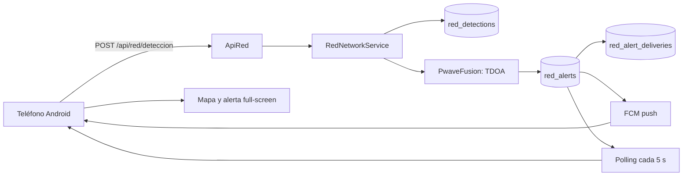

# Red SIGRA de teléfonos

## Qué es

SIGRA convierte teléfonos Android en una red de sensores sísmicos. Cada teléfono escucha su
acelerómetro, detecta la llegada de la onda P y envía al servidor la hora y su ubicación. Cuando
varios teléfonos coinciden en tiempo y espacio, el servidor estima el origen del sismo y alerta a
los teléfonos cercanos con los segundos que faltan para la onda S.

Es una **estimación experimental**. No sustituye al Servicio Geológico Colombiano (SGC), a la
UNGRD ni a ningún sistema oficial de alerta temprana.

## Por qué la onda P

Un sismo genera ondas P y S. La P es más rápida (~6 km/s en corteza somera) y suele sentirse como
un golpe seco; la S es más lenta (~3.5 km/s) y concentra buena parte del daño. Si la red detecta la
P y conoce la distancia al epicentro, puede estimar cuánto falta para la S:

```
t_S = t_origen + distancia / 3.5
aviso = t_S - ahora
```

Para un teléfono a 140 km, la diferencia es de decenas de segundos. Para uno a 10 km, el aviso es
mínimo o nulo: por eso la app también muestra instrucciones de autoprotección de inmediato.

## Arquitectura



### Componentes

| Componente | Función |
|---|---|
| `ApiRed` | Contrato HTTP, autenticación y validación de forma. |
| `RedNetworkService` | Reglas de negocio, fusión, entrega y estadísticas. |
| `PwaveFusion` | Agrupación, localización TDOA, magnitud y confianza. |
| `FcmService` | Push opcional con Firebase HTTP v1. |
| `RedDeviceModel` y compañía | Acceso a las cuatro tablas de la red. |
| App Android | Sensor, ubicación, registro, polling, notificaciones y mapa. |

### Tablas

- `red_devices`: teléfonos, token hash, ubicación, preferencias y último latido.
- `red_detections`: cada onda P reportada, con hora del dispositivo y del servidor.
- `red_alerts`: eventos fusionados (ciudadanos o SGC).
- `red_alert_deliveries`: a qué teléfono se entregó cada alerta y con qué ETA.

La migración es `20261103000001_CreateRedNetworkTables.php`.

## Algoritmo de fusión

1. **Agrupación.** Se toman detecciones de los últimos 25 s dentro de 80 km de la primera
   detección. La primera llegada corresponde a la estación más cercana; se toleran 2 s de desfase
   de reloj y se elige una detección por teléfono.
2. **Localización TDOA.** Para cada punto candidato de una malla alrededor del centro del grupo se
   calcula `t0_i = t_i - distancia_i / Vp`. El punto que minimiza la desviación estándar de los
   `t0_i` es el epicentro estimado. Se hace una segunda pasada fina.
3. **Magnitud.** Regresión empírica simple con la mayor aceleración observada y su distancia al
   epicentro: `M ≈ 2 + log10(PGA_cm/s²) + log10(distancia_km)`, acotada a 1.5–7.5.
4. **Confianza.** Combina número de teléfonos, confianza individual y residual temporal.
5. **Umbral.** Se emite alerta si hay al menos 3 teléfonos, `M >= 3.0` y confianza `>= 0.45`.
6. **Deduplicación.** Una alerta activa a menos de 100 km y 120 s se actualiza en vez de duplicarse.
7. **Entrega.** Se calculan los teléfonos en línea dentro del radio y su ETA de onda S. Se inserta
   una entrega y se envía push si hay token FCM; el polling cubre a los demás.

### Ejemplo verificado

Con tres estaciones simuladas alrededor de `4.60, -74.10`, el servidor estimó:

- epicentro `4.5994, -74.1008` (error < 1 km),
- residual temporal `0.005 s`,
- magnitud `3.7`, confianza `0.881`,
- alerta entregada a los teléfonos dentro del radio.

La prueba está en `tests/PwaveFusionTest.php`.

## Web instalable y alertas del navegador

La web de SIGRA ya no usa SMS. En su lugar:

- **PWA instalable** con `public/manifest.webmanifest`, iconos y `sw.js` en la raíz.
- **Web Notifications** con permiso explícito y botón de campana en el navbar.
- **Overlay de emergencia** con magnitud, distancia y cuenta atrás hasta la onda S.
- **Panel `/red`** con propagación animada de ondas P/S, riesgo personal, alertas compartibles y
  estado “Red en vivo” en el navbar.
- **Reproducción de actividad** en `/sismos` para animar la secuencia de eventos sobre el mapa.

El service worker cachea solo estáticos y una pantalla offline. Las rutas `/api/*` y las páginas
dinámicas siempre van a la red para no mostrar datos sísmicos obsoletos.

## App Android

Carpeta `mobile/`. Kotlin + Jetpack Compose.

### Funciones

- Servicio en primer plano con sensor de aceleración (`TYPE_LINEAR_ACCELERATION` o acelerómetro).
- Filtro pasa-banda 0.5–10 Hz y detector STA/LTA con confirmación de 3 muestras.
- Ubicación con FusedLocationProvider.
- Registro y token de dispositivo.
- Latido cada 30 s y polling de alertas cada 5 s.
- Notificación de alta prioridad, pantalla completa, sonido y vibración.
- Mapa OpenStreetMap con epicentros, radio de alerta y eventos SGC.
- Ajustes de radio, magnitud mínima, notificaciones y baja de la red.
- Push FCM opcional y reintento por polling.

### Compilar

Requisitos: Android Studio (Ladybug o superior) o JDK 17 + SDK 35.

```bash
cd mobile
cp local.properties.example local.properties
# edita sdk.dir, sigra.baseUrl y sigra.apiKey
./gradlew :app:assembleDebug
```

En Windows:

```powershell
cd mobile
copy local.properties.example local.properties
.\gradlew.bat :app:assembleDebug
```

El APK queda en `mobile/app/build/outputs/apk/debug/app-debug.apk`.

Para producción, `sigra.baseUrl` debe ser `https://tu-dominio/` y `sigra.apiKey` debe
coincidir con `APP_API_TOKEN` o `red.appKey` del servidor.

### Probar con el emulador

1. Arranca el servidor local: `php spark serve --host 0.0.0.0 --port 8080`.
2. En `local.properties` usa `sigra.baseUrl=http://10.0.2.2:8080/`.
3. Compila e instala el APK en el emulador.
4. Acepta ubicación y notificaciones; activa el monitoreo.
5. En el emulador, usa **Extended controls > Virtual sensors > Accelerometer** para mover el sensor.
   La alerta se emite cuando tres o más teléfonos reportan la misma onda P.

## Operación

```bash
php spark migrate --all
php spark red:estado
php spark red:limpiar --dias 7
```

Cron sugerido:

```cron
*/5 * * * * cd /ruta/sigra && php spark red:limpiar --dias 7 >/dev/null 2>&1
```

Si usas FCM, mantén el archivo de cuenta de servicio fuera del repositorio y con permisos 600.
Nunca lo pongas en `public/`.

## Limitaciones y ética

- El acelerómetro de un teléfono no es un sismógrafo. Ruido, movimiento, bolsillos y fundas generan
  falsos positivos.
- La ubicación GPS no siempre es precisa; la app no debe usarse para localización epicentral fina.
- La magnitud es preliminar y puede diferir de la del SGC.
- La red necesita densidad: con pocos teléfonos no hay confirmación.
- Relojes desincronizados degradan la localización. La app debe usar hora automática.
- No prometas "predicción". Es detección temprana de un sismo en curso, no predicción.
- Publica siempre el aviso de naturaleza experimental y enlaza a las autoridades.
- Considera protección de datos: consentimiento, finalidad, retención, baja y acceso.

## Escalabilidad

1. **Mensajería.** Sustituir la entrega síncrona por una cola (Redis/Beanstalk/SQS) y workers.
2. **Base de datos.** Índices espaciales (MySQL `POINT` + `SPATIAL INDEX` o PostGIS) para radios.
3. **Push.** Enviar por lotes con FCM HTTP v1; limitar a los teléfonos dentro del radio.
4. **Densidad.** Segmentar por región y exigir un mínimo de teléfonos por celda.
5. **Calidad.** Añadir Play Integrity, firma de muestras y detección de sensores falsos.
6. **Validación.** Contrastar alertas ciudadanas con el feed SGC y cerrar alertas cuando el SGC
   publique el evento oficial.
7. **Observabilidad.** Métricas de detecciones/minuto, falsos positivos, latencia de entrega y
   teléfonos activos por zona.
