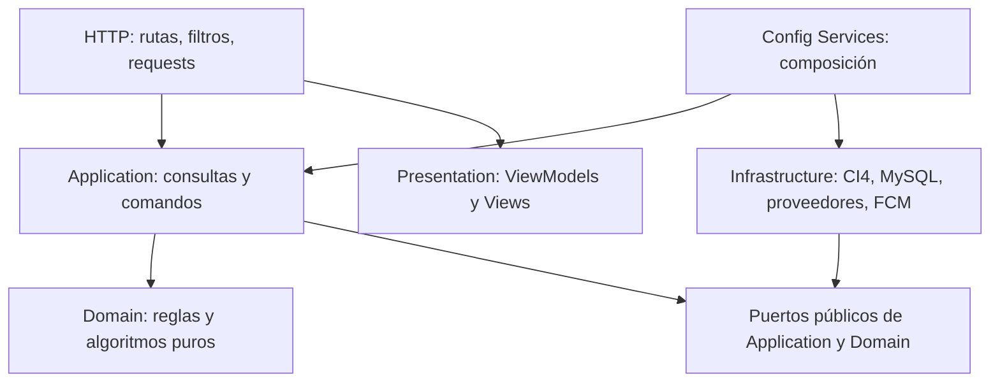

# Arquitectura modular de SIGRA

SIGRA es un monolito modular CI4. Este cambio implementa la separación del documento
`SIGRA_ARQUITECTURA_MODULAR_RIGUROSA.md`, sobre la base
`2f7b173708544da95a5868da6068dec4322e2d54`. Las mejoras posteriores se registran en [estado de recomendaciones](../RECOMMENDATIONS_STATUS.md).



- [Límites y propiedad](module-boundaries.md).
- [Dependencias y pruebas](dependency-rules.md).
- [Cambios operativos y compatibilidad](migration.md).
- [Contrato OpenAPI](../api/openapi.yaml).
- [Publicación de la reestructuración en Git](git-publication.md).
- [Decisiones ADR](adr/0001-modular-monolith.md).

## Implementación

`SeismicCatalog` prepara listado, detalle, histórico, polling y recursos JSON.
`CitizenReports` separa entrada HTTP, intensidad percibida, reglas puras, envío,
reconciliación y persistencia. `SeismicIngestion` recibe una lista de fuentes,
correlaciona conservando ambas referencias, escribe mediante el catálogo y registra
el lote. `SensorNetwork` registra dispositivos, latidos y detecciones; su comando
`RegisterDetectionHandler` entrega evidencia a `Alerting`. La evaluación científica,
las decisiones auditadas y la entrega son responsabilidades separadas.
`System` contiene health y páginas informativas. `Shared` contiene reloj, distancia,
caché abstracta, errores y fronteras HTTP.

Los antiguos nombres `App\Controllers`, `App\Libraries` y `App\Models` se conservan
como adaptadores de compatibilidad cuando tienen consumidores. Las rutas apuntan a
controladores modulares. El autoload existente `App => app/` cubre `Modules` y `Shared`;
la prueba de presentación verifica la resolución real de vistas por namespace.

## Verificación

```bash
bash tools/test-architecture.sh
# Solo con una base desechable creada expresamente:
python3 tools/test-mysql-architecture.py --database sigra_architecture_test
```

Las pruebas unitarias de ingesta/sensores usan puertos en memoria, no credenciales ni
proveedores reales. Las pruebas CGI ejercitan rutas y filtros reales con una conexión
intencionalmente inaccesible. La prueba de presentación comprueba HTML real y un JSON
capturado del serializador anterior. Las pruebas de MySQL migran una base explícita,
omiten completamente `.env`, comprueban persistencia e idempotencia y revierten fixtures.
El runner MySQL añade 27 recorridos CGI de éxito para cada raíz web y comprueba que la alerta y su auditoría
se confirman juntas; un fallo de auditoría revierte la alerta y bloquea su entrega.
El workflow incluye MariaDB aislada; su ejecución remota debe verificarse antes de publicar.

## Límites comprobables

Esta migración no certifica validez científica ni rendimiento de una red real. El
estado `confirmed_by_policy` describe un umbral experimental, nunca confirmación del
SGC. Los tests de carga, de campo, latencia y falsos positivos requieren datos y
revisión especializada. No se afirma capacidad de 10.000 dispositivos.

Se conserva el almacenamiento horario heredado de eventos/reportes para no reinterpretar
fechas existentes. El reloj y las auditorías nuevas usan UTC; convertir columnas
heredadas requiere una migración de datos separada y contratos específicos.

La API móvil conserva claves de compatibilidad y tokens por dispositivo; esta
refactorización no incorpora un proveedor de identidad ni resuelve ataques Sybil.
Android permanece en desarrollo y en repositorio separado; no se añade `mobile/`.

## Actualización automática sin cron

Por petición del usuario se conserva la ruta de compatibilidad `/sismos/sync` como
disparador explícito de actualización. El render inicial no descarga feeds: el navegador
consulta esa ruta al cargar y cada 15 segundos. `RefreshCatalogHandler` invoca la ingesta
si venció el intervalo; el coordinador de archivos controla caché, exclusión y reintentos.
Las demás lecturas siguen separadas de la ingesta. La excepción se documenta en ADR-009.
